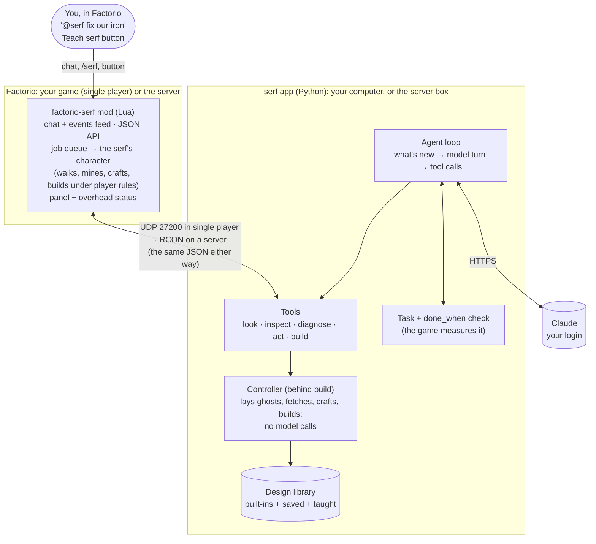

# Architecture

## Direction (2026-10-18): one good player

All testing and iteration now centers on **one model-driven player in the world**. The multi-agent crew (an Opus
foreman directing Sonnet workers) is paused; its design, results and how to re-enable it are in
[crew-design.md](crew-design.md). Why: in a 3-hour live run the crew spent most of its time thinking, the characters
were idle 55-65% of game time, and a brain without hands added cost, not output. The way to scale is more
individually capable players, not a hierarchy.

The product: **a player brings their own Claude login and their own agent just joins the game**. Since mod 0.2.0
(2026-10-19): start your game with `--enable-lua-udp 27200`, run `serf`, type `/serf add`. Several people means
several independent serfs, each on its owner's login.

## How it works: one player, one serf (2026-10-19)

One order, start to finish:
1. You type `@serf fix our iron` in chat. The mod adds it to its feed.
2. The app polls the feed every half second, sees the chat, and starts a model turn with a short "what's new" and
   a one-line state of the base.
3. The model calls tools. Reading tools (`diagnose`, `inspect`, `look`) answer from the game at once. `act`
   queues jobs on the character (walk, mine, place...), which then run in game time under player rules.
   `build` hands a whole plan to the controller: stamp a design as ghosts, fetch the items, craft what's
   missing, build it all (96 entities in 45 s in d4) with no model calls.
4. The model puts the order on its task list with a `done_when` check ("iron used +600/min"). The app asks the
   game every few seconds; the task closes only when the check holds for 2 minutes.
5. The serf reports with numbers and 2-3 options, shows "waiting for orders" and stops until you answer.

### Why each mechanism exists

| Mechanism | Why, with one serf | Only needed for |
|---|---|---|
| Model outside the game, app + mod | Mods can't call the internet; the model has to run in a separate program | - |
| UDP and RCON (two pipes, one API) | Single player has no RCON; servers do and most can't take UDP (the headless crash). Same requests, same code | - |
| Packet framing and pacing | A map read is ~1 MB; a UDP packet holds 64 KB | - |
| Job queue in the mod | The character must act in game time (walking takes seconds) while the model thinks | - |
| Controller (`build`) | One model call does 50-100 placements; without it every belt is a model round trip | - |
| Design library, Teach serf | Building from blueprints is how good players work, and it's how you tell the serf "build it like this" | - |
| Task + `done_when` check | The serf proves the order worked (measured by the game) instead of saying so | - |
| Panel, overhead state | You see what it's doing and thinking while it works | - |
| Feed with a cursor per app | With one app: just the inbox. With several apps on one server, each reads its own copy | 2+ apps on one world |
| Owner, ownership guards, per-player cap | A friend's app on your server can't drive your serf or run Lua | multiplayer |
| `@serf` alias | "@serf" means *your* serf when everyone's is called serf | multiplayer |
| **Crew leftovers** (paused design, still loaded): foreman (`crew/foreman.py`), chat router, `zone` (claim build sites from teammates), shared `marks`, `post_task` to others, idle sweep, "built by a teammate" and "feeds a teammate's belt" guards | Nothing for one serf | the paused crew mode |

The leftovers do nothing for one serf: the foreman is off, the idle sweep skips solo agents, and nobody else claims
zones. They still cost something: four of the serf's tools (`zone`, `mark`, `marks`, `post_task`) and prompt lines
about teammates. Candidate cleanup: hide those tools and lines unless crew mode is on.

### How players' apps reach the game (mod 0.2.0)

- **Transports** (`crew/game.py` picks one): RCON (`crew/rcon.py`, a server operator, trusted) or localhost UDP
  (`crew/udp.py` + `mod/.../scripts/link.lua`, a player's own app). Mods can't make web requests, so the model
  always runs outside the game. Factorio 2.0's `helpers.recv_udp`/`send_udp` read a packet on the machine that
  got it and turn it into an input action: every peer runs the request identically (no desync), and
  `send_udp(port, reply, player_index)` sends the reply only from that player's machine. Works in single player
  and from a multiplayer client, with no access to the server needed.
- **Framing:** `CC1 <id> <part> <parts>\n<chunk>`, chunks of 60 KB cut on UTF-8 boundaries. Replies go out at
  most 3 packets per tick from a per-machine queue: a burst bigger than the app's socket buffer (208 KB on stock
  Linux) is dropped. The app asks for an 8 MB buffer.
- **Clients and the feed:** every orchestrator is a client (RCON: `client` in the request, default `rcon`; UDP:
  `p<player_index>`). Chat and events go into one feed (`storage.feed`, 600 entries); each client reads from its
  own cursor, so nobody steals anyone's messages. An agent records its client and owner; its job results and
  events go only to its client. Polling is the heartbeat (offline after 20 s).
- **Guards for UDP clients** (`guard` in control.lua): no `eval`/`chat`/`brand`/`as_player`; drive only your own
  agents; names can't be taken over; `factorio-serf-serfs-per-player` cap (2); no starter kit in multiplayer;
  `factorio-serf-player-serfs` off disables it all. The app on the server's own machine (player 0) may spawn for a
  named player.
- **`/serf add`** pushes an `add` event to that player's app (or to an operator's `crew up --host-serfs`), which
  picks a name (`serf`, then `serf-<player>`), spawns next to the player and starts the brain. `@serf` in chat
  means the speaker's own serf (`Orchestrator._alias`). Serfs persist in the save; the app re-attaches its own
  on restart. State per world: `~/.local/state/serf/world-<seed>`.
- **Known Factorio issue:** a headless 2.0.77 server started with `--enable-lua-udp` crashes when a packet arrives
  ("Trying to add invalid input action to the closure"), so UDP is only for players' own games, and
  `tests/test_udp.py` tests the in-game side through the RCON-only `as_player` op (same dispatch and guards). The
  real client path needs a game client to test.

| Part | Runs on | Does |
|---|---|---|
| Player (`crew/agent.py`) | one model (Sonnet or Opus), one character | Plays: decides, acts, checks its own work. Owns a to-do list on the board. |
| Tools (`crew/tools.py`, `crew/late_tools.py`) | plain code | `act` (place, mine, craft, connect, configure, ...), `build` (stamp/paste/ghosts/line in one call, done by the controller), `diagnose`, copy/paste, planners, `network`, `research`. |
| Controller (`crew/controller.py`) | plain code behind `build` | Lays a plan as ghosts, fetches items, crafts, mines raw resources, clears blockers, builds, refuels. |
| Checks (`orchestrator._task_checks`, mod `scripts/orders.lua`) | the game | A board task with `done_when` closes only when its check holds 2 min. |
| Mod (`mod/factorio-serf`) | Lua | Characters under player rules, job queue, observations, late-game queries, checks. JSON API over RCON (`/crew`) or localhost UDP; `/serf` for players. |
| Apps (`crew/cli.py`) | Python | `serf`: a player's own app (UDP, join mode). `crew up`: a server operator's (RCON; `--host-serfs`). |

What people see (one player at a time, so make it watchable): the panel (top left, `/crew-panel`) is titled
"serf · with otterplex" (`[identity]` in crew.toml; the user's name for it: short to type, "@serf fix our
iron". The prompt treats it as a fellow engineer and teammate) and shows, per agent: model, a live state line, its task, and its
latest thought in quotes. The same state floats over the character's head. States: `thinking... 12s` (a model
turn is running; with the job if the character is also moving), the current job (`walking to 60,10`, `mining`,
`building`), `paused: hourly spend cap`, `retrying: <error>`, `offline` (no orchestrator poll for 20 s), and
`idle: out of Claude usage`, and `waiting for orders from <owner>` after it finished an order and asked what's
next (the user's call, 2026-10-19: "it should ask for guidance upon finishing a task"). It works one order at a
time, stays on it until its check holds, notes side problems instead of chasing them, then reports what it did,
the numbers, and 2-3 things worth doing next.
Pushed by `Agent.show()` (crew/agent.py) through the mod's `status` API; drawn by `scripts/panel.lua`.

Test rules: **biters are always off in tests** (`crew/peace.py`, applied by `scripts/instance.py` and
`scripts/server.sh` on every start); tests run on copies of saves, never the original.

### Design library (2026-10-19)

The user: "when the agent builds it should use blueprints as much as possible... ideally it can maintain its own
library". Before this, blocks were stamped from 10 built-in designs, but connections were hand-placed (d3 run 2:
27 hand-place calls vs 2 stamps) and `copy` was never used. Now (`crew/blueprint_lib.py`):
- One library, two kinds: built-in designs (crew/blueprints, entity lists with ports) and learned ones in
  `~/.local/state/factorio-serf/designs/<name>.json` (per user, every world), which keep Factorio's blueprint
  string so they rebuild exactly (undergrounds, filters, recipes) through the mod's paste.
- `copy ... note="what it makes, rate, ports"` saves a verified build; `designs` lists both kinds (yours marked,
  with use counts); `designs forget=` moves one aside; `build kind=stamp name=` builds either kind.
- Teaching: the Teach serf shortcut (ctrl+shift+T) or `/serf learn [name]` sends the held blueprint, or every
  blueprint in a held book (nested too), named from labels (a clash with a built-in gets `-yours`); the mod's
  `blueprint_info` gives each footprint and cost. Held straight from the library: "Game blueprints" records are
  save state and read anywhere; "My blueprints" records exist only on that player's machine, so they're read in
  single player only (on a server the player drags it to Game blueprints or the inventory). Same code either way.
- Prompt: blueprints first; hand-place only connections and one-offs; save what works; prefer the player's designs.
- Test: `tests/test_library.py` (copy, rotated stamp keeps recipes and directions, learn, forget).

### Thinking time (notes, 2026-10-19)

The model thinks for 39-45% of wall time (median ~2.5-4 s per call, longer after map reads), and in the iron run the
character also sat with nothing queued 24% of the time. The user's read: this is a general limit of agents today;
short of a faster model there's no way to fake zero downtime, so focus on tools and consistency. What helps
anyway, roughly in order of payoff:
- Bigger tools: one call doing more (the `build` controller did 50-87 entities per call with no model calls).
  Each new macro (find_space, calc, build line) removed several think-act rounds.
- Fewer map reads: they're the slowest turns (median 6.7 s after a map). find_space answers "where does this fit".
- Queue the next jobs before thinking (the job queue already runs while the model thinks; the prompt asks for it,
  but it isn't enforced or measured per turn yet).
- A fast model for routine steps (walk, fetch, refuel) and the strong one for design: not tried in solo mode.
- Show the thinking (done): the panel's live thought makes the wait feel like a teammate thinking, not lag.

What to improve next (from `docs/log-analysis/README.md`): score by science packs consumed per minute and per
dollar (A3); keep the character busy while the model thinks (queue the next jobs before thinking); visibility of
belts, inserters and fluids (C1, C5); `place` clears trees itself (C3); pole routing (C2).

## Build log

- 2026-10-18: architecture agreed; order graph + scheduler (`crew/orders.py`), controller (`crew/controller.py`),
  actor (`crew/actor.py`), coordinator order tools (`crew/foreman.py`), mod queries `zone`/`sources`/`check`
  (`mod/factorio-serf/scripts/orders.lua`). Controller tested without a model on stage S7: pasted a 34-piece smelting
  column on open ground, fetched belts/inserters from chests, mined stone, crafted furnaces, built it all in 108 s,
  check passed. Actor + scheduler + coordinator not yet tested end to end.
- 2026-10-18: PAUSED for a prior-art review before building further. Several existing projects use the same
  "model picks the task, mod executes" split (AI Player v3, AI Companion / factorio-ai-companion, factorioctl,
  Factorio AI Coworker, FLE). Decide reuse vs build before continuing; see docs/prior-art.md.
- 2026-10-18: prior-art review done (docs/prior-art.md, notes in research_notes/). Verdict: keep the orchestrator
  and order design; port the game layer module by module from MIT projects (factorio-mcp in llm-play-factorio,
  factorio-codex); no fork or rebase.
- 2026-10-18 18:52: first live run (S7 robots save, Opus coordinator + 3 Haiku actors, "@all our iron is the
  bottleneck, go fix it"). Coordinator diagnosed "iron isn't short, it's stuck" in 60 s ($0.30) and wrote 3 orders;
  an actor closed a one-tile belt gap (iron 771 -> 1094/min); the coordinator then found copper was the real limit
  and re-targeted. 14 min: 12 orders, 4 wasted on impossible checks (zone vs base counts). Cost: coordinator $3.18,
  three actors ~$0.12 total. Fixes: checks take "scope": "base"; a check that can never pass (asks for more than
  exist) blocks immediately with the reason instead of retrying.
- 2026-10-18 19:50: order system benchmark (round 17, Opus coordinator + Haiku actors, s3-research-rush): 0 new
  techs in ~45 min, ~$25 per run; stopped. Failure modes: one-moment checks passed while problems recurred, the
  coordinator fixed symptoms (repeated refuel orders), malformed orders (connect with cargo as item), long belt
  routes failing. Judged a regression vs the player crews (+6 techs in 35-59 min).
- 2026-10-18 19:50: SIMPLIFIED. Removed actor.py, orders.py and the scheduler. Kept: the controller, as one worker
  tool `build` (stamp/paste/ghosts/line in one call: tested, a 51-piece red science block in 38 s); board tasks with
  optional game-evaluated done_when that must hold 2 min; foreman hands out outcomes with checks. Known issue: long
  `line` routes still fail near dense base areas even after automatic splitting. Not benchmarked yet.
- 2026-10-18 20:31-23:45: live run on a copy of the user's world (feldspar, 42 h, biters on): Opus foreman + 4
  Sonnet workers. 3 new techs, 5 checked tasks, 5 deaths to biters in 30 min, characters idle 55-65%. Stopped as
  unproductive.
- 2026-10-18: PIVOT to one good player; crew design archived in crew-design.md. Biters always off in tests.
